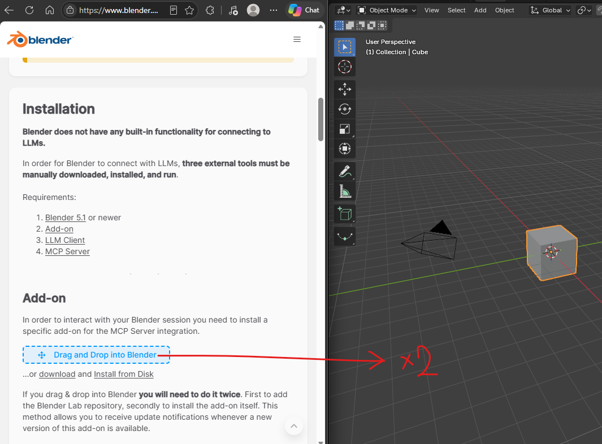
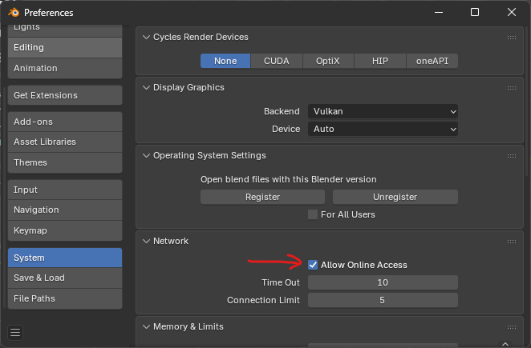
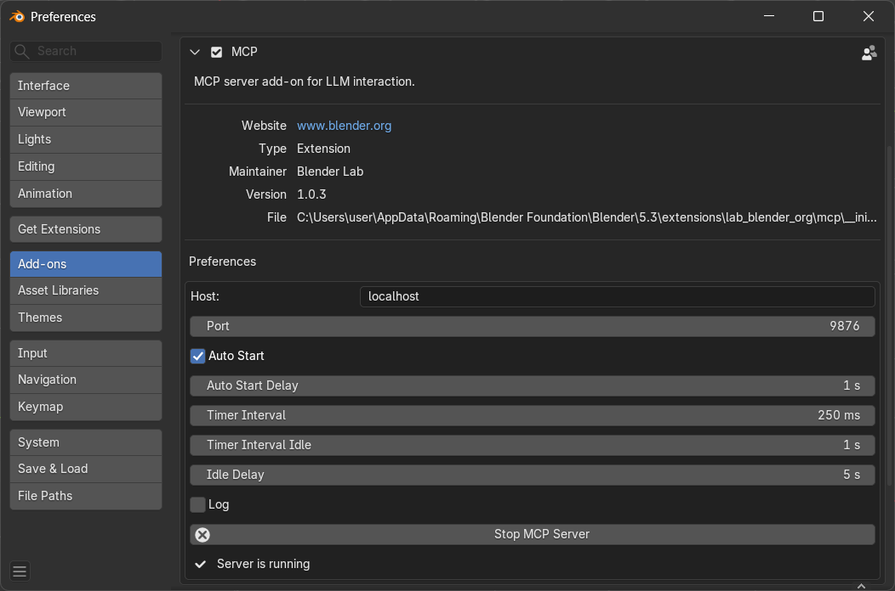
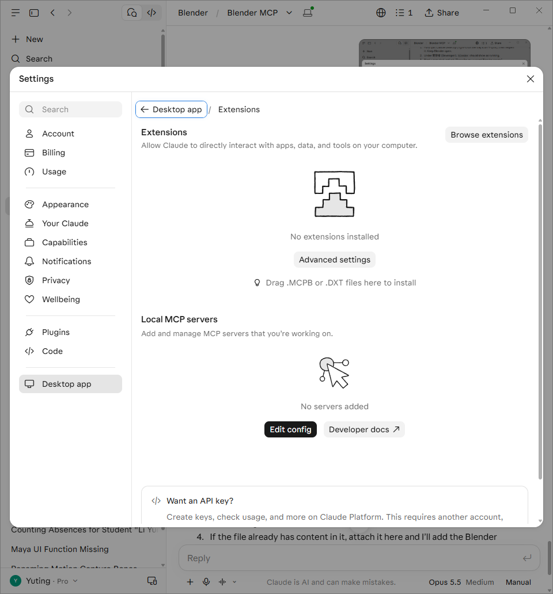
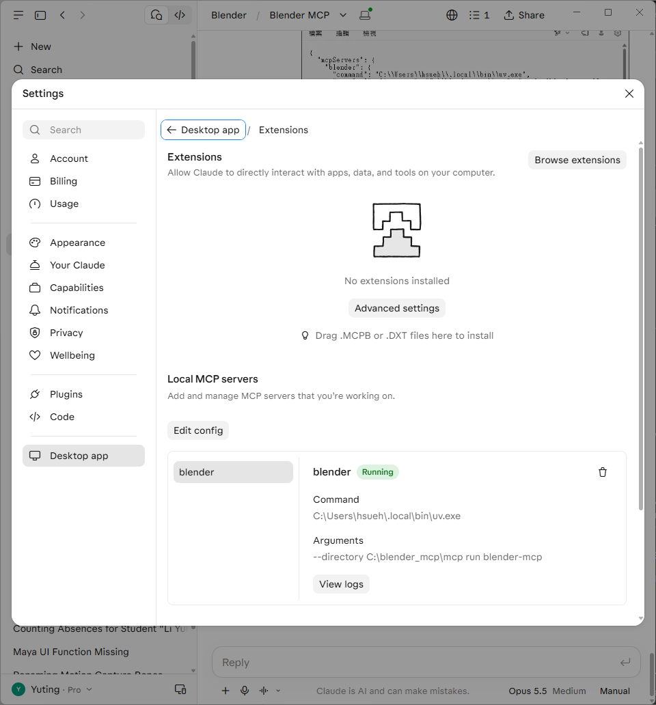

# blender-claude-mcp

A practical guide to connecting **Blender** to **Claude Desktop** on Windows with the **official Blender Lab MCP server**. Once it's connected, Claude can inspect your scene, take screenshots, search the Blender Python API and manual, and run `bpy` code in your live Blender session.

This repo only has documentation and a sample config. The MCP server itself is maintained by Blender Lab: <https://projects.blender.org/lab/blender_mcp>

> Tested on Windows 11 with Blender 5.3.0, Blender Lab MCP add-on 1.0.3 and Claude Desktop (November 2026).

---

## How it works

```
Claude Desktop  ──stdio──>  blender-mcp server (uv)  ──TCP localhost:9876──>  MCP add-on inside Blender
```

There are two parts, and you need both:

1. **The Blender add-on.** It runs a small bridge server inside Blender, on port 9876.
2. **The MCP server.** Claude Desktop starts it as a local process, and it passes Claude's requests on to the add-on.

---

## Requirements

- **Blender 5.1 or newer.** 5.2 LTS (supported until July 2028) or 5.3 both work.
- **Claude Desktop**
- **Git**
- **[uv](https://docs.astral.sh/uv/)**, the Python package manager
- Port **9876** free. Don't run another Blender MCP add-on at the same time.

Install uv if you don't have it:

```powershell
powershell -ExecutionPolicy ByPass -c "irm https://astral.sh/uv/install.ps1 | iex"
uv --version
```

---

## Step 1: Install the add-on in Blender

1. Open <https://www.blender.org/lab/mcp-server/>.
2. **Drag and drop the "Drag and Drop into Blender" button into Blender *twice*:**
   - the first drop adds the Blender Lab extension repository (you'll get update notices from it later);
   - the second drop installs the **MCP** add-on.

   

3. If Blender says *"Online access must be enabled"*, go to **Edit → Preferences → System → Network** and turn on **Allow Online Access**.

   
4. Go to **Edit → Preferences → Add-ons**, expand **MCP**, and click **Start MCP Bridge Server**.
   - The status line should say **Server is running**.
   - Turn on **Auto Start** so it starts with Blender next time. Auto Start only takes effect when Blender launches, so start it by hand the first time.

   

---

## Step 2: Get the MCP server

Clone the official repo. This guide clones it to `C:\blender_mcp`:

```powershell
cd C:\
git clone https://projects.blender.org/lab/blender_mcp.git
```

Check that it runs. The first run downloads its dependencies:

```powershell
uv --directory C:\blender_mcp\mcp run blender-mcp --help
```

> ⚠️ The official README also has a **"Running"** section that uses `llama-server` and `--transport http --port 9191`. That section is for **local LLMs**, not Claude Desktop. **Skip it.** Claude Desktop starts the server over stdio by itself.

---

## Step 3: Register it in Claude Desktop

Open the config file. Where the button is depends on your Claude Desktop version:

- **Newer versions:** **Settings → Desktop app → Extensions → Manage**. Scroll to **Local MCP servers** and click **Edit config**.
- **Older versions:** **Settings → Developer → Edit Config**.



This opens `claude_desktop_config.json`, or a File Explorer window with it selected. If you get the folder, right-click the file and choose **Open with → Notepad**.

> The file isn't always in the same place. It can be `%APPDATA%\Claude\claude_desktop_config.json`, or somewhere like `%LOCALAPPDATA%\Claude-Data\claude_xxxxxxxx\claude_desktop_config.json`. Use the **Edit config** button so you get the right one.

Add a `blender` entry inside `"mcpServers"`. If you already have other servers there, keep them and put a comma between the entries:

```json
{
  "mcpServers": {
    "blender": {
      "command": "C:\\Users\\YOUR_NAME\\.local\\bin\\uv.exe",
      "args": ["--directory", "C:\\blender_mcp\\mcp", "run", "blender-mcp"]
    }
  }
}
```

A full example is in [`examples/claude_desktop_config.example.json`](examples/claude_desktop_config.example.json).

**If your file has no `"mcpServers"` yet** (on a fresh install it usually has only `"preferences"`), put the block right after the first `{` and keep everything else. The top of the file should look like this:

```json
{
  "mcpServers": {
    "blender": {
      "command": "C:\\Users\\YOUR_NAME\\.local\\bin\\uv.exe",
      "args": ["--directory", "C:\\blender_mcp\\mcp", "run", "blender-mcp"]
    }
  },
  "preferences": {
    ...
```

Check that:
- `"preferences"` appears **only once**, below `mcpServers`, and its line ends with a single `{`;
- there's a **comma** after the `}` that closes `mcpServers`.

Notes:
- Use **double backslashes** (`\\`) in JSON paths.
- If `uv` is on your PATH, `"command": "uv"` also works. A full path to `uv.exe` is more reliable. Run `where uv` to find it.
- **Back up** your existing config before you edit it.

**Alternative:** the Blender Lab page also offers a `.mcpb` bundle. In Claude Desktop, go to **Settings → Extensions** and drag the file onto that page (don't double-click it). Use **either** the bundle **or** the config entry, not both.

---

## Step 4: Restart and test

1. **Fully quit** Claude Desktop: right-click the tray icon and choose **Quit**. Closing the window isn't enough.
2. Make sure Blender is open and shows **Server is running**.
3. Reopen Claude Desktop. On the same page where you clicked **Edit config**, `blender` should be listed under **Local MCP servers** with a green **Running** label. If it shows an error, click **View logs**.

   
4. Start a **new chat** and ask:

   > Describe my current Blender scene

   If Claude lists the default Camera, Cube and Light, everything is connected. 🎉

---

## Day to day, and setting up a second PC

**You only do this once per computer.** After that:
- the add-on stays installed for that Blender version, and **Auto Start** starts the bridge when Blender opens;
- Claude Desktop starts the server from the config whenever it opens.

So you just open Blender and Claude Desktop. If Blender is closed, the Blender tools won't respond until you open it again.

**New Blender version (for example 5.4 or 6.0):** each version keeps its own settings folder. On first launch, accept the splash screen's offer to **load settings from the previous version**, and the add-on comes along. If you skip it, install the add-on again (Step 1).

**Updates:** Blender tells you when the add-on has an update, and you install it from **Edit → Preferences → Get Extensions**. Run `git pull` in `C:\blender_mcp` now and then to keep the server matching the add-on.

**Second PC (for example home and office):** your chats, Projects and account skills sync with your Claude account, but local MCP servers **don't**. On each PC:

1. Install Blender and the add-on (Step 1). Turn on **Allow Online Access** and **Auto Start**.
2. Install uv and Git, and clone the server (Step 2).
3. Add the `blender` entry to **that PC's** config file (Step 3). Change `YOUR_NAME` in the `uv.exe` path to that PC's Windows user name, since it can be different on each machine.
4. Fully restart Claude Desktop and check that it shows **Running** (Step 4).

> uv's installer says *"To add C:\Users\YOUR_NAME\.local\bin to your PATH, restart your shell"*. Claude Desktop doesn't need uv on your PATH if the config uses the **full path** to `uv.exe`. For the commands in Step 2, open a new PowerShell window.

---

## What Claude can do with it

The official server exposes tools like these:

| Area | Tools |
|---|---|
| Scene inspection | `get_objects_summary`, `get_object_detail_summary`, `get_blendfile_summary_*` |
| Seeing the screen | `get_screenshot_of_window_as_image`, `get_screenshot_of_area_as_image` |
| Navigation | `jump_to_tab_by_name`, `jump_to_view3d_object_by_name` |
| Rendering | `render_viewport_to_path`, `render_thumbnail_to_path` |
| Docs | `search_api_docs`, `get_python_api_docs`, `search_manual_docs` |
| Doing things | `execute_blender_code` (runs Python / `bpy` in your session) |

It has no asset-library or AI model-generation tools. Those are in other, community MCPs.

---

## Troubleshooting

| Symptom | Fix |
|---|---|
| `connection refused` on `localhost:9876` | The bridge inside Blender isn't running. Click **Start MCP Bridge Server**. Your Claude setup is probably fine. |
| "Server is stopped" after install | Start it by hand once, and turn on **Auto Start**. |
| Online access error | **Edit → Preferences → System → Network → Allow Online Access** |
| Port conflict | Turn off any other Blender MCP add-on (for example the community "MCP for Blender") or anything else on port 9876. Only one can run at a time. |
| Can't find **Developer → Edit Config** | In newer versions it's in **Settings → Desktop app → Extensions → Manage → Local MCP servers → Edit config**. |
| Config error after editing | Usually a missing comma or an extra or missing `{`. See the example at the end of Step 3. Make sure `"preferences"` appears only once. |
| `blender` shows an error in Local MCP servers | Click **View logs**. Most often `C:\blender_mcp\mcp` doesn't exist (run the clone in Step 2) or the `uv.exe` path is wrong. |
| Blender tools don't appear in Claude | Check the JSON is valid, check the paths, **fully** quit and reopen Claude, then start a **new** chat. |
| `uv` not found | Use the full path to `uv.exe` in `"command"`. |
| Blender too old | Update to 5.1 or newer. |

---

## ⚠️ Safety

The MCP server runs model-written Python with **Blender's full permissions**, and there are no guards on it. That Python can read and write files on your computer.

- Save your work often, and use **File → Save As** before you let Claude make big changes.
- Keep production files away from it until you trust the workflow.
- Read what Claude is about to run when it matters.

---

## Tips for Maya users

| Maya | Blender |
|---|---|
| Y-up | **Z-up** |
| Construction history | **Modifier stack** (non-destructive, reorderable) |
| Attribute Editor + Channel Box | **Properties panel** (tabs down its left side) + **N-panel** in the viewport |
| Display layers / groups | **Collections** |
| Component mode (F8) | **Edit Mode** (Tab) |
| Hypershade | **Shading** workspace / Shader Editor |
| Arnold | **Cycles** (path tracer); **EEVEE** is the real-time renderer |
| MEL / `maya.cmds` | Python **`bpy`** |
| Menu sets / shelves | **Workspaces** (tabs at the top: Layout, Modeling, Shading…) |

On first launch, choose the **Industry Compatible** keymap. It feels much closer to Maya. You can change it later under **Edit → Preferences → Keymap**.

Good first prompts:
- "I'm a Maya user. How do I do *[Maya thing]* in Blender? Show me on my scene."
- "Model a simple low-poly table and explain each step in Blender terms."
- "Make an FBX export with settings that suit Unity."

---

## Links

- Official Blender Lab MCP server: <https://www.blender.org/lab/mcp-server/>
- Source code: <https://projects.blender.org/lab/blender_mcp>
- Claude connector listing: <https://claude.com/connectors/blender>
- uv: <https://docs.astral.sh/uv/>

## License

The documentation in this repo is under the MIT License. The Blender Lab MCP server is a separate project under its own license (GPL-3.0).
